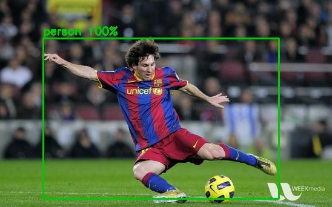

# Smart Shopping Assistant for the Visually Impaired

A modular computer-vision application that looks at a camera frame, identifies objects in real time, and turns the result into short spoken guidance such as **"bottle on your left, nearby"**.


*Example output on an OpenCV sample image (`samples/messi5.jpg`, from the OpenCV repository).*

## Features
- Real-time object detection with **MobileNet-SSD** through OpenCV's DNN module (CPU only)
- Plain-language guidance: **direction** (left / ahead / right) and a **distance estimate** (very close / nearby / further away)
- Speaks the most relevant objects first (largest = closest), limited to 3 per message
- **Cooldown** so the same message is not repeated every frame
- Works on a single image or a live webcam stream
- Clean separation of concerns, so each part can be tested or swapped independently

## Architecture
```
camera / image ──► ObjectDetector ──► describer ──► Speaker (text-to-speech)
                  (detector.py)     (describer.py)   (speech.py, cooldown)
```
| Module | Responsibility |
|---|---|
| `assistant/detector.py` | Loads the model, returns `Detection` objects (label, confidence, box) |
| `assistant/describer.py` | Pure functions: position, proximity bucket, spoken sentence (unit-tested) |
| `assistant/speech.py` | Text-to-speech with repeat suppression; falls back to printing |
| `assistant/cli.py` | `image` and `webcam` commands |

## Setup
```bash
pip install -r requirements.txt
./scripts/download_models.sh          # downloads the ~23 MB model into ./models
```

## Usage
```bash
python -m assistant.cli image path/to/photo.jpg --save annotated.jpg
python -m assistant.cli webcam                 # press q to quit
python -m assistant.cli --conf 0.6 webcam      # stricter confidence threshold
```
Example output:
```
1 object(s) in 188 ms
  person       100%  box=(71,63,460,328)
Guidance: person ahead, very close.
```

## Tests and measurements
```bash
python -m unittest discover -s tests -t .       # 6 unit tests
python scripts/measure_latency.py photo.jpg     # detector latency
```
Measured on a single-core CPU container (548x342 image, 50 runs after warm-up):
**median 71.9 ms, p95 76.4 ms, roughly 14 frames per second** for detection alone.
Speed will differ on your hardware.

## Limitations (please read)
- The pretrained model knows only **20 PASCAL VOC classes** (person, bottle, chair, potted plant, etc.),
  so it cannot recognise most grocery products yet.
- Distance is a **heuristic** based on how much of the frame an object fills, not a real measurement.
- **Detection accuracy has not been evaluated on a labelled dataset** in this repository, so no accuracy figure is claimed.

## Roadmap
- Fine-tune or swap in a detector trained on grocery/retail items and report mAP on a labelled set
- Barcode and text (OCR) reading for product labels and prices
- Depth sensing or monocular depth estimation for real distance
- Audio cues (beeps) for obstacles, and an offline/mobile build
